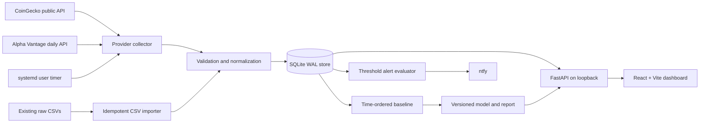
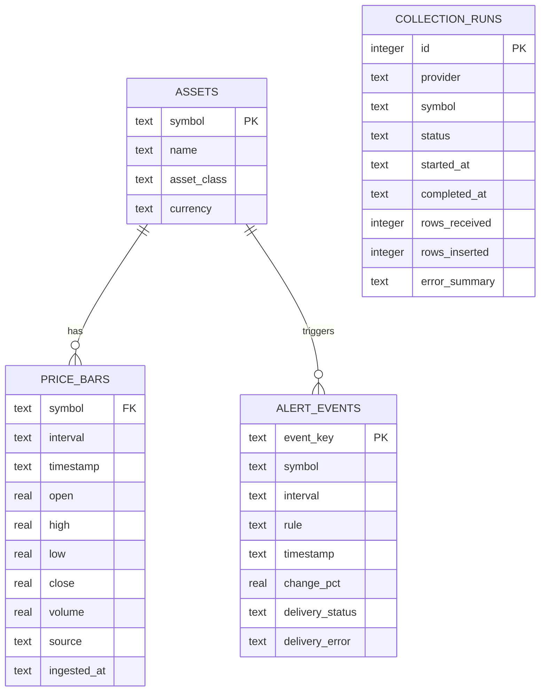

# Architecture

## Runtime shape

The deployment is local-first: no PostgreSQL, Docker, GPU, Redis, or external queue is required. FastAPI and the production static dashboard share port 8000 after `npm run build`; development uses Vite on 5173. Both services bind to `127.0.0.1` by default.

## Modules

- `backend/database.py`: SQLite schema, CSV import, freshness metadata, job and alert history.
- `backend/collector.py`: CoinGecko/Alpha Vantage adapters, bounded HTTP retries/timeouts, per-provider failure isolation.
- `backend/analysis.py` and `backend/train_model.py`: leakage-aware features, chronological splits, baseline comparison, versioned artifacts.
- `backend/alerts.py`: interval-move rule, deduplication, ntfy delivery status.
- `backend/api.py`: health, overview, assets, bars, job history, alerts, model report, and built frontend.
- `frontend/src/`: typed API client, navigation, tables, chart, market/service/AI/alert states.
- `deploy/`: systemd user service/timer templates.

## Data model

Prices use UTC ISO-8601 timestamps. The key `(symbol, interval, timestamp, source)` makes ingestion append-only and idempotent; conflicts are ignored rather than overwriting historical values. SQLite WAL and a busy timeout support concurrent dashboard reads while a scheduled writer runs.

## Failure and recovery behavior

Provider failures are logged by provider and do not prevent another provider from being attempted. HTTP GET retries are bounded and respect `Retry-After`; all requests have connect/read timeouts. A missing stock key is recorded as a skipped job. Raw CSVs are read but never rewritten by the new backend. SQLite and model artifacts live under `data/processed/` and should be backed up before restore/retraining.

## Security boundary

The API has no login/authentication and is safe only as a local research tool while loopback-bound. CORS permits the two local Vite origins and GET only. Provider secrets are loaded from environment/`.env`, not source or responses. Parameterized SQL is used for request-controlled filters. Do not expose port 8000 to a LAN or public network without adding authentication, authorization, TLS, request limits, and security review.
