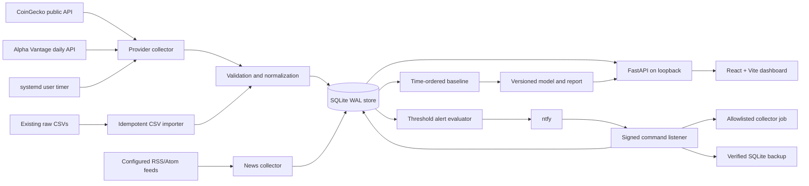
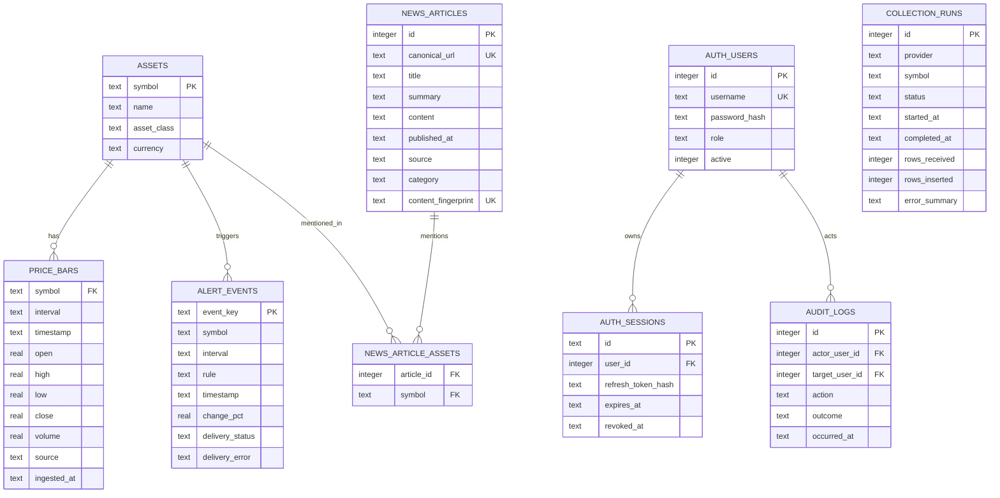

# Architecture

## Runtime shape

The deployment is local-first: no PostgreSQL, Docker, GPU, Redis, or external queue is required. FastAPI and the production static dashboard share port 8000 after `npm run build`; development uses Vite on 5173. Both services bind to `127.0.0.1` by default.

## Modules

- `backend/database.py`: SQLite schema, CSV import, freshness metadata, job and alert history.
- `backend/collector.py`: CoinGecko/Alpha Vantage adapters, bounded HTTP retries/timeouts, per-provider failure isolation.
- `backend/analysis.py` and `backend/train_model.py`: leakage-aware features, chronological splits, baseline comparison, versioned artifacts.
- `backend/alerts.py`: interval-move rule, deduplication, ntfy delivery status.
- `backend/news.py` and `backend/run_news_collector.py`: configurable RSS/Atom feed adapter, bounded fetch, normalization, deterministic categorization, asset matching and deduplication.
- `backend/api.py`: health, overview, assets, bars, job history, alerts, news, model report, and built frontend.
- `backend/auth.py`: Argon2 credential hashing, signed access tokens, rotating persisted refresh sessions, RBAC, CLI account bootstrap and audit records.
- `backend/command_listener.py`: optional HTTPS ntfy subscriber; verifies HMAC, timestamp, admin identity and persistent nonce before dispatching allowlisted read commands, market collection or SQLite backup.
- `frontend/src/`: typed API client, navigation, tables, chart, market/service/AI/alert/news states.
- `deploy/`: systemd user service/timer templates.

## Data model

Prices use UTC ISO-8601 timestamps. The key `(symbol, interval, timestamp, source)` makes ingestion append-only and idempotent; conflicts are ignored rather than overwriting historical values. SQLite WAL and a busy timeout support concurrent dashboard reads while a scheduled writer runs.

News tables are added idempotently by the existing `CREATE TABLE IF NOT EXISTS` initialization; no existing market rows are rewritten. News deduplication uses canonical URLs, content fingerprints, and same-day normalized-title matching. It is not a versioned migration framework.

## Failure and recovery behavior

Provider failures are logged by provider and do not prevent another provider from being attempted. HTTP GET retries are bounded and respect `Retry-After`; all requests have connect/read timeouts. A missing stock key is recorded as a skipped job. Raw CSVs are read but never rewritten by the new backend. SQLite and model artifacts live under `data/processed/` and should be backed up before restore/retraining.

News feed failures are isolated per feed. RSS/Atom requests require HTTPS, have a 2 MiB response cap, a fixed timeout, and do not follow redirects. News collection does not call model inference. AI summaries, sentiment, event extraction, and scheduled news collection are not implemented.

## Security boundary

Data APIs require bearer authentication. Passwords are Argon2-hashed; access tokens are signed and short-lived, and high-entropy refresh tokens are rotated, persisted as hashes, and revocable per session. `ADMIN`, `USER` and `READ_ONLY` roles are enforced; user administration and real test-notification delivery require ADMIN. Authentication and account changes are audited. Login and API requests have per-process IP rate limits. Health, login and refresh remain public. CORS uses a local-origin allowlist by default, and security headers are applied to responses.

The API is still intended for loopback use only. Rate limits are process-local and are not shared across workers. Browser refresh credentials live in session storage, so this application does not claim protection against same-origin script compromise. Provider secrets are loaded from environment/`.env`, not source or responses. Parameterized SQL is used for request-controlled filters. Do not expose port 8000 to a LAN or public network without TLS, deployment-specific access controls, shared rate limiting, and security review.
